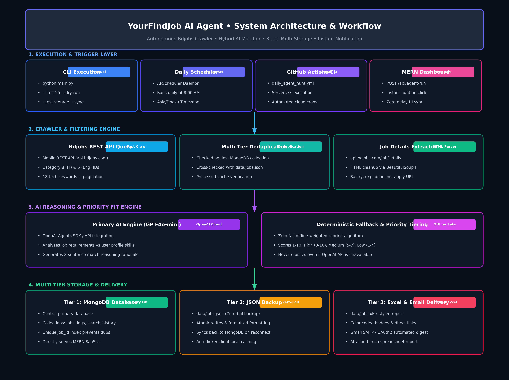
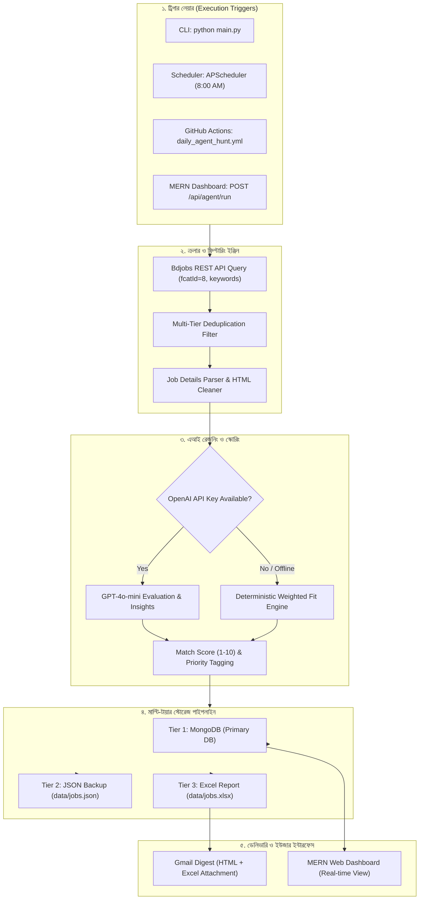

# 🤖 YourFindJob AI Agent — সম্পূর্ণ আর্কিটেকচার ও টেকনিক্যাল গাইড (README-2.md)

> **প্রজেক্টের নাম:** YourFindJob AI Agent  
> **সংক্ষিপ্ত পরিচিতি:** বিডিজবস (Bdjobs) থেকে প্রতিদিন স্বয়ংক্রিয়ভাবে টেকনোলজি চাকরি সংগ্রহ, কৃত্রিম বুদ্ধিমত্তা (AI) দিয়ে ম্যাচিং স্কোর নির্ধারণ, ৩-স্তরের ফল্ট-টলারেন্ট স্টোরেজে (MongoDB + JSON + Excel) সংরক্ষণ এবং প্রফেশনাল ইমেইল ডাইজেস্ট পাঠানোর একটি সম্পূর্ণ অটোনোমাস পাইথন AI এজেন্ট।

---

## 📌 সূচিপত্র (Table of Contents)
1. [প্রজেক্ট ওভারভিউ (Project Overview)](#১-প্রজেক্ট-ওভারভিউ)
2. [কি কি টেকনোলজি ও লাইব্রেরি ব্যবহার করা হয়েছে (What Was Used)](#২-কি-কি-টেকনোলজি-ও-লাইব্রেরি-ব্যবহার-করা-হয়েছে)
3. [কেন ব্যবহার করা হয়েছে (Why Each Tech Was Chosen)](#৩-কেন-ব্যবহার-করা-হয়েছে)
4. [কিভাবে কাজ করে ও বাস্তবায়ন পদ্ধতি (How It Works & Implementation)](#৪-কিভাবে-কাজ-করে-ও-বাস্তবায়ন-পদ্ধতি)
5. [সম্পূর্ণ সিস্টেম আর্কিটেকচার ডায়াগ্রাম (Full System Architecture)](#৫-সম্পূর্ণ-সিস্টেম-আর্কিটেকচার-ডায়াগ্রাম)
6. [মাল্টি-টায়ার স্টোরেজ পাইপলাইন (Multi-Tier Storage Pipeline)](#৬-মাল্টি-টায়ার-স্টোরেজ-পাইপলাইন)
7. [ডাটাবেস কালেকশন ও স্কিমা (Database Collections & Schema)](#৭-ডাটাবেস-কালেকশন-ও-স্কিমা)
8. [কমান্ডসমূহ ও রানিং গাইড (CLI Commands Reference)](#৮-কমান্ডসমূহ-ও-রানিং-গাইড)

---

## ১. প্রজেক্ট ওভারভিউ

**YourFindJob AI Agent** হলো একটি এন্টারপ্রাইজ-গ্রেড ব্যাকএন্ড পাইথন অটোমেশন সিস্টেম। এটি মানুষের কোনো হস্তক্ষেপ ছাড়াই প্রতিদিন সকাল ৮:০০ টায় ইন্টারনেটে নতুন টেকনোলজি ও সফটওয়্যার জব খোঁজে, ইউজারের স্কিল ও প্রোফাইলের সাথে জবের সামঞ্জস্য যাচাই করে এবং সংগৃহীত জবগুলো ডাটাবেস, ব্যাকআপ ফাইল ও ইমেইলে সরবরাহ করে।

---

## ২. কি কি টেকনোলজি ও লাইব্রেরি ব্যবহার করা হয়েছে

| ক্যাটাগরি | টেকনোলজি / লাইব্রেরি | সংস্করণ | ভূমিকা ও কাজের ক্ষেত্র |
| :--- | :--- | :--- | :--- |
| **কোর ল্যাঙ্গুয়েজ** | **Python** | 3.10+ | সম্পূর্ণ এজেন্টের কোর ইঞ্জিন ও বিজনেস লজিক। |
| **AI ও রেজনিং** | **OpenAI API / Agents SDK** | `openai>=1.50.0`, `openai-agents` | জব বর্ণনা বিশ্লেষণ, ১০-পয়েন্ট স্কেলে ফিটনেস স্কোরিং ও সামারি তৈরি। |
| **নেটওয়ার্কিং ও ক্রলিং** | **Requests** | `requests>=2.31.0` | Bdjobs-এর অফিশিয়াল রেস্ট এপিআই থেকে সরাসরি ডাটা ফেচিং। |
| **HTML পার্সিং** | **BeautifulSoup4** | `beautifulsoup4>=4.12.0` | জবের বর্ণনা ও এইচটিএমএল ট্যাগ ক্লিন করে প্লেইন টেক্সট এক্সট্রাকশন। |
| **প্রাইমারি ডাটাবেস** | **MongoDB / PyMongo** | `pymongo>=4.6.0`, `dnspython` | রিয়েল-টাইম সেন্ট্রাল স্টোরেজ ও ইনডেক্সড ডাটা কোয়েরি। |
| **লোকাল স্প্রেডশিট** | **OpenPyXL** | `openpyxl>=3.1.2` | কালার-কোডেড, ফিল্টারসহ প্রফেশনাল Excel (`.xlsx`) রিপোর্ট তৈরি। |
| **শিডিউলিং ও ক্রন** | **APScheduler** | `apscheduler>=3.10.4` | প্রতিদিন সকাল ৮:০০ টায় স্বয়ংক্রিয় ব্যাকগ্রাউন্ড এক্সিকিউশন। |
| **ইমেইল অটোমেশন** | **smtplib & Google API Client** | Built-in / `google-api-python-client` | রেসপনসিভ এইচটিএমএল ডাইজেস্ট ও Excel এটাচমেন্টসহ ইমেইল সেন্ডিং। |
| **কনফিগারেশন** | **PyYAML & Python-dotenv** | `pyyaml>=6.0.1`, `python-dotenv` | সিকিউর এনভায়রনমেন্ট ভ্যারিয়েবল ও সেন্ট্রাল `config.yaml` পার্সিং। |
| **টার্মিনাল ইউজার ইন্টারফেস**| **Rich** | `rich>=13.7.0` | টার্মিনালে কালারফুল টেবিল, ব্যানার, প্রগ্রেস বার ও লাইভ লগিং। |

---

## ৩. কেন ব্যবহার করা হয়েছে (Why Each Tech Was Chosen)

### ১. Bdjobs REST API ক্রলিং (Selenium/Playwright-এর পরিবর্তে `requests`)
- **কেন?**: ব্রাউজার অটোমেশন (Selenium/Puppeteer) ভারী, স্লো এবং সার্ভারলেস বা ক্লাউডে চালাতে গেলে ঘন ঘন মেমোরি ক্র্যাশ করে।
- **সুবিধা**: Bdjobs-এর মোবাইল এন্ডপয়েন্ট ব্যবহার করায় মিলি-সেকেন্ডে লাইটওয়েট JSON রেসপন্স পাওয়া যায়, যা **১০০% ব্যান্ডউইথ সাশ্রয়ী ও ১০ গুণ দ্রুত**।

### ২. ৩-স্তরের মাল্টি-টায়ার স্টোরেজ (Multi-Tier Storage Pipeline)
- **কেন?**: একক ডাটাবেসের ওপর নির্ভর করলে ডাটাবেস ডাউন হলে পুরো সিস্টেম বন্ধ হয়ে যায়।
- **সমাধান**:
  1. **Tier 1 (MongoDB)**: ওয়েব ড্যাশবোর্ডের জন্য দ্রুত কুয়েরি ও ফিল্টারিং।
  2. **Tier 2 (JSON Backup)**: ডাটাবেস ডাউন থাকলেও জিরো ডাটা লস ব্যাকআপ (`data/jobs.json`)।
  3. **Tier 3 (Excel Report)**: নন-টেকনিক্যাল ইউজারদের জন্য অফলাইন শেয়ারযোগ্য ফাইল (`data/jobs.xlsx`)।

### ৩. হাইব্রিড এআই স্কোরিং ইঞ্জিন (OpenAI + Deterministic Fallback)
- **কেন?**: OpenAI কোটা শেষ হয়ে গেলে বা নেটওয়ার্ক বিচ্ছিন্ন থাকলে যেন হান্টিং বন্ধ না হয়।
- **সমাধান**:
  - প্রাইমারি: **GPT-4o-mini** দিয়ে রেজনিং ও সামারি।
  - ফলব্যাক: পাইথনের নিজস্ব **অ্যালগরিদমিক ওয়েটেড স্কোরার** (যা রিকোয়ার্ড স্কিলস, অভিজ্ঞতা ও লোকেশন মিলিয়ে ১-১০ স্কেলে নিখুঁত স্কোর দেয়)।

### ৪. ডুয়েল ইমেইল আর্কিটেকচার (Gmail SMTP + OAuth2)
- **কেন?**: গুগল পাসওয়ার্ড পলিসি পরিবর্তন করলেও সার্ভিস যেন নির্বিঘ্নে চালু থাকে।
- **সমাধান**: 
  - Standard: Gmail App Password (`smtplib`)।
  - Cloud Enterprise: Google Service Account / OAuth2 Token।

---

## ৪. কিভাবে কাজ করে ও বাস্তবায়ন পদ্ধতি (How It Works)

### ধাপ ১: স্বয়ংক্রিয় সার্চ ও আবিষ্কার (`tools/bdjobs_search.py`)
- `config.yaml`-এ নির্ধারিত টেক ক্যাটাগরি (Category 8: IT & Category 5: Engineering) এবং ১৮টি টেক কীওয়ার্ড (`python`, `react`, `node`, `frontend`, ইত্যাদি) দিয়ে Bdjobs API-তে রিকোয়েস্ট পাঠানো হয়।
- একাধিক পেজ পেজিনেশন (`pg=1, 2, 3...`) সমর্থন করে, যাতে ইউজার ২৫ বা ৫০টি জব চাইলে সব পেজ ঘুরে পর্যাপ্ত জব সংগ্রহ করা যায়।

### ধাপ ২: মাল্টি-টায়ার ডুপ্লিকেট চেকার (`tools/duplicate_checker.py`)
- কোনো জব আইডি পাওয়ার পর সেটি ৪টি স্থানে চেক করা হয়:
  1. MongoDB-র `jobs` কালেকশনে আছে কি না?
  2. `data/jobs.json`-এ সেভ আছে কি না?
  3. `data/processed_jobs.json`-এর হিস্ট্রিতে আছে কি না?
  4. `data/jobs.xlsx`-এর স্প্রেডশিটে আগে লেখা হয়েছে কি না?
- যদি পাওয়া যায়, তৎক্ষণাৎ বাদ দেওয়া হয় (যাতে কোনো জব বারবার প্রসেস না হয়)।

### ধাপ ৩: ডিটেইলস এক্সট্রাকশন (`tools/job_details.py`)
- নতুন জবগুলোর পূর্ণাঙ্গ ডেসক্রিপশন API থেকে নেওয়া হয়।
- `BeautifulSoup` দিয়ে HTML ট্যাগ সরিয়ে ক্লিন টেক্সট, স্যালারি, কাজের লোকেশন, ডেডলাইন, এবং ডিরেক্ট অ্যাপ্লাই লিংক প্রস্তুত করা হয়।

### ধাপ ৪: AI ম্যাচিং ও প্রায়োরিটি স্কোরিং (`tools/job_analyzer.py`)
- জবের স্কিল ও ইউজারের পছন্দের স্কিল বিশ্লেষণ করে ১০-পয়েন্ট স্কেলে ফিটনেস স্কোর নির্ধারণ করা হয়:
  - **High Priority (৮ - ১০)**: স্কিল এবং রিকোয়ারমেন্টের সাথে সর্বোচ্চ ম্যাচ।
  - **Medium Priority (৫ - ৭)**: আংশিক ম্যাচ।
  - **Low Priority (১ - ৪)**: কম প্রাসঙ্গিক।

### ধাপ ৫: মাল্টি-টায়ার পারসিস্টেন্স (`mongodb_manager.py`, `json_manager.py`, `excel_manager.py`)
- একই সাথে ৩টি স্টোরেজে ডাটা রাইট করা হয়:
  1. **MongoDB**: `jobs` কালেকশনে `upsert` করা হয়।
  2. **JSON**: ফরম্যাটেড JSON ফাইলে অ্যারে আকারে অ্যাপেন্ড করা হয়।
  3. **Excel**: `openpyxl` দিয়ে স্টাইল করা গ্রিন/অ্যাম্বার ব্যাজ, ক্লিকযোগ্য লিংকসহ নতুন রো তৈরি হয়।

### ধাপ ৬: ইমেইল নোটিফিকেশন ডেলিভারি (`tools/email_sender.py`)
- সংগৃহীত হাই-প্রায়োরিটি জবগুলোকে শীর্ষে রেখে সুন্দর আধুনিক HTML ইমেইল টেমপ্লেট তৈরি করা হয়।
- তৈরি হওয়া তাজা Excel ফাইলটি এটাচমেন্ট হিসেবে ইউজারের জিমেইলে অটোমেটিক পাঠিয়ে দেওয়া হয়।

---

## ৫. সম্পূর্ণ সিস্টেম আর্কিটেকচার ডায়াগ্রাম



### ইন্টারেক্টিভ আর্কিটেকচার ফ্লো (Mermaid Flowchart)


---

## ৬. মাল্টি-টায়ার স্টোরেজ পাইপলাইন

```text
┌────────────────────────────────────────────────────────────────────────┐
│                        AI AGENT EXECUTION ENGINE                       │
└───────────────────────────────────┬────────────────────────────────────┘
                                    │
               ┌────────────────────┼────────────────────┐
               ▼                    ▼                    ▼
     ┌──────────────────┐ ┌──────────────────┐ ┌──────────────────┐
     │      TIER 1      │ │      TIER 2      │ │      TIER 3      │
     │     MongoDB      │ │   Local JSON     │ │   Excel Report   │
     │  (Central Cloud) │ │ (Zero-Fail File) │ │ (Human Readable) │
     ├──────────────────┤ ├──────────────────┤ ├──────────────────┤
     │ • Port 27017     │ │ • data/jobs.json │ │ • data/jobs.xlsx │
     │ • Indexed Query  │ │ • Atomic Writes  │ │ • Color Badges   │
     │ • Real-time API  │ │ • Offline Backup │ │ • Hyperlinks     │
     └──────────────────┘ └──────────────────┘ └──────────────────┘
```

---

## ৭. ডাটাবেস কালেকশন ও স্কিমা

MongoDB-র `yourfindjob_db` ডাটাবেসের অধীনে ৪টি প্রধান কালেকশন ব্যবহৃত হয়:

1. **`jobs`**:
   - সকল সংগৃহীত জবের তথ্য (`job_id`, `title`, `company`, `location`, `salary`, `match_score`, `priority`, `deadline`, `url`, `posted_date`, `status`)।
   - `job_id` ফিল্ডে ইউনিক ইনডেক্স থাকায় কোনো ডুপ্লিকেট ডাটা তৈরি হতে পারে না।
2. **`processed_jobs`**:
   - পূর্বে প্রসেস হওয়া জব আইডি এবং প্রসেসিংয়ের সময়কাল যাতে দ্বিতীয়বার একই জব প্রসেস না হয়।
3. **`search_history`**:
   - প্রতিটি সার্চ সেশনের বিস্তারিত হিস্ট্রি (কখন সার্চ হয়েছে, কতটি পাওয়া গেছে, কয়টি নতুন যোগ হয়েছে)।
4. **`agent_logs`**:
   - এজেন্টের টার্মিনাল এক্সিকিউশন স্ট্রিম ও লাইভ লগ।

---

## ৮. কমান্ডসমূহ ও রানিং গাইড (CLI Commands Reference)

প্রজেক্টের রুট ডিরেক্টরিতে টার্মিনাল ওপেন করে নিচের কমান্ডগুলো চালানো যাবে:

### ১. লাইভ ড্রাই-রান (ইমেইল ছাড়া ৫টি জব পরীক্ষা)
```bash
python main.py --dry-run --limit 5
```

### ২. ডাটাবেস ও স্টোরেজ স্বয়ংক্রিয় ভ্যালিডেশন
```bash
# শুধুমাত্র MongoDB কানেকশন ও ইনডেক্স টেস্ট
python main.py --test-db

# লোকাল JSON ব্যাকআপ স্টোরেজ টেস্ট
python main.py --test-json

# ৩-স্তরের সম্পূর্ণ মাল্টি-টায়ার স্টোরেজ স্যুট টেস্ট
python main.py --test-storage
```

### ৩. অফলাইন ডাটাবেস সিঙ্ক
```bash
# লোকাল JSON ফাইলের অফলাইন ডাটা সরাসরি MongoDB-তে সিঙ্ক করা
python main.py --sync
```

### ৪. ব্যাকগ্রাউন্ড শিডিউলার চালু করা (প্রতিদিন সকাল ৮:০০ টায়)
```bash
python main.py --scheduler
```

---

## ৯. সংক্ষেপ (Summary)

| প্রশ্ন | উত্তর |
| :--- | :--- |
| **কি কাজ করে?** | বিডিজবস থেকে রিয়েল-টাইম টেকনোলজি জব খুঁজে AI দিয়ে বাছাই করে ডাটাবেস ও ইমেইলে পৌঁছে দেয়। |
| **সবচেয়ে বড় বিশেষত্ব কি?** | **জিরো-ফেল মাল্টি-টায়ার আর্কিটেকচার** — ইন্টারনেট বা ডাটাবেস বন্ধ থাকলেও লোকাল ফাইলে ব্যাকআপ থাকে এবং সিস্টেম ক্র্যাশ করে না। |
| **ওয়েবসাইটের সাথে কানেকশন কি?** | ব্যাকএন্ডের এক্সপ্রেস API সরাসরি এই এজেন্টের ডাটাবেস ও ফাইলগুলো রিড করে ড্যাশবোর্ডে রিয়েল-টাইম প্রদর্শন করে। |
